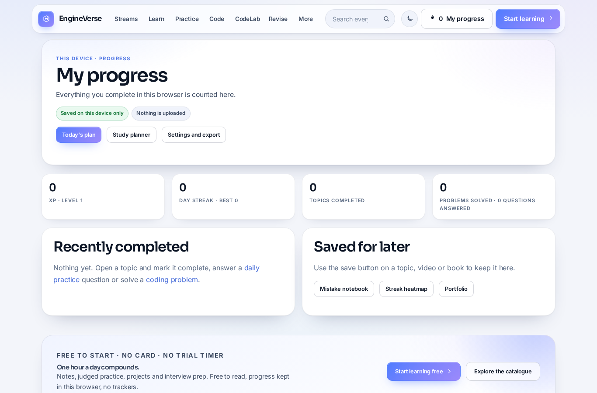
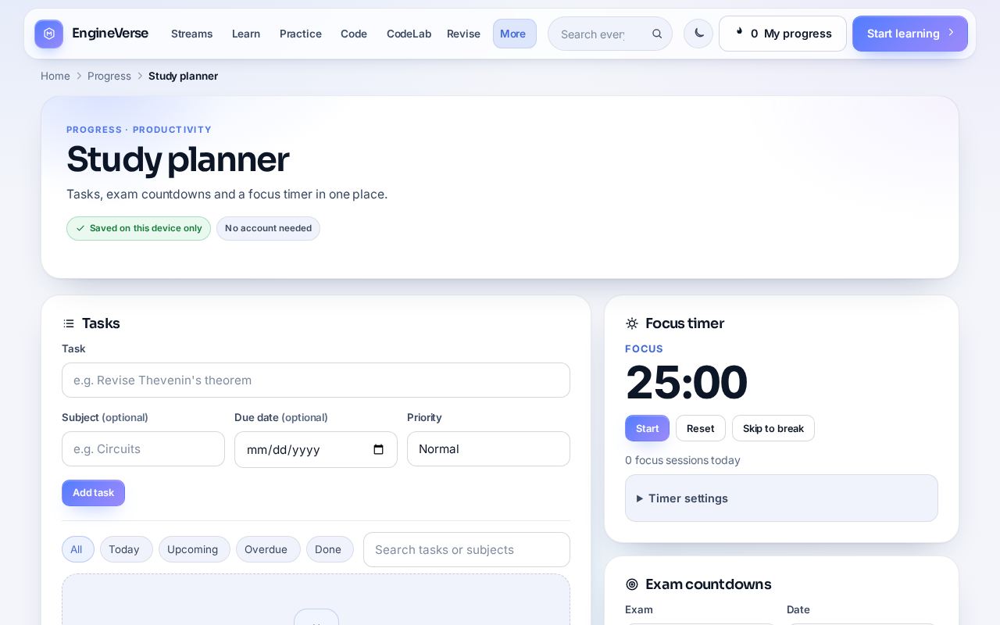
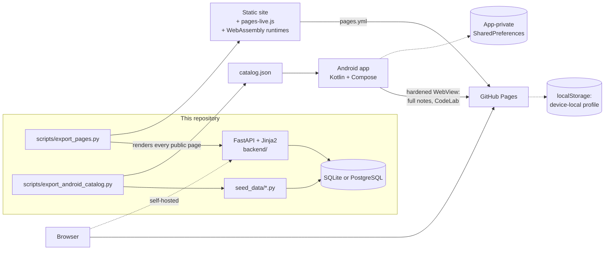

# EngineVerse

[](https://github.com/sauravprivatelimited369-byte/Engine_Verse/actions/workflows/ci.yml)
[](https://github.com/sauravprivatelimited369-byte/Engine_Verse/actions/workflows/pages.yml)
[](https://github.com/sauravprivatelimited369-byte/Engine_Verse/actions/workflows/android-build.yml)
[](LICENSE)

EngineVerse is a free, open-source study platform for engineering students. It
offers structured notes for 93 subjects, judged coding practice, daily problem
sets, flashcards, a study planner, a multi-language code playground, and
links to internships and scholarships. You can use it in three ways:

| | What it is | Accounts | Where your progress lives |
|---|---|---|---|
| **Website on GitHub Pages** | A static copy of the site, rebuilt and deployed by Actions from this repository | None | Your browser (export and import as JSON) |
| **Android app** | A native Kotlin app with an offline catalogue, planner and progress, which opens the website for full notes and code | None | The app's private storage |
| **Self-hosted full website** | The FastAPI application with accounts, a server-side judge and PostgreSQL | Yes | Your server's database |

**Website address:** `https://sauravprivatelimited369-byte.github.io/Engine_Verse/`.
It is served once GitHub Pages is enabled for this repository (Settings > Pages >
Source: GitHub Actions). The Pages workflow builds and tests the site on every
push either way.

> The seeded catalogue is broad starter material, not a complete degree
> syllabus. Topics not yet expert-reviewed are labelled as drafts. EngineVerse
> is not an accredited institution, and its certificates are not qualifications.

<p>
  
  
</p>

<sub>Screenshots of the static build, taken in headless Chromium at 1366×900 and 1280×800.</sub>

## Contents

- [What you can do](#what-you-can-do)
- [AI assistant](#ai-assistant-optional)
- [Architecture](#architecture)
- [Run it locally](#run-it-locally)
- [Tests and checks](#tests-and-checks)
- [Deployment](#deployment)
- [Android app](#android-app)
- [Privacy and security](#privacy-and-security)
- [Known limitations](#known-limitations)
- [Documentation](#documentation)
- [Contributing and licence](#contributing-and-licence)

## What you can do

| Area | Pages copy | Full website |
|---|---|---|
| **Learn**: 45 branches, 93 subjects, 406 topics with notes at four depths, diagrams, interactive 3D models, formula sheets, videos and books | ✓ | ✓ |
| **Practise**: 534 questions, daily problem sets, a mistake notebook and revision flashcards | ✓ (progress in the browser) | ✓ (progress in your account) |
| **Code**: 105 judged problems in 14 sheets, 10 language paths and the CodeLab compiler | ✓ Runs in your browser through WebAssembly | ✓ Server judge, when the operator configures one |
| **Plan**: study planner with tasks, exam countdowns and a focus timer | ✓ | ✓ |
| **Track**: dashboard, streak heatmap and portfolio of completed work | ✓ On this device | ✓ Across devices |
| **Opportunities**: internships, scholarships, olympiads and hackathons, linked to official pages | ✓ | ✓ |
| **Help**: support and feedback, privacy and terms, a 404 page | ✓ (feedback through GitHub issues) | ✓ |
| **Ask**: an AI student copilot on `/assistant` and a floating launcher, powered by the operator's n8n workflow | n/a — no server to forward to; the page says so | ✓ when `ENGINEVERSE_ASSISTANT_URL` is configured |
| Accounts, two-factor sign-in, community posts, leaderboard, certificates | n/a | ✓ |

### Code playground

Each language runs on its real compiler or interpreter. Nothing is simulated.

- **On the Pages copy and in the Android app**, code runs in your browser,
  inside a Web Worker. It uses CPython 3.12 (Pyodide), Clang for C and C++,
  javac with TeaVM for Java, Roslyn for C#, the TypeScript compiler, GopherJS
  for Go, rustc's Miri for Rust, SQLite and a Bash interpreter. Each runtime is
  downloaded the first time you pick its language. The Pages workflow
  compiles and runs a real program in every language before deploying.
- Known differences: Go in the browser cannot read stdin, and the Rust worker
  wraps snippets that lack `fn main`. A runtime that fails to download is
  reported as **not run**.
- **On a self-hosted site**, the server judge runs code only when the operator
  configures one. Production defaults to `ENGINEVERSE_JUDGE=disabled`.

More detail on every feature is in [docs/FEATURES.md](docs/FEATURES.md).

## AI assistant (optional)

`/assistant` and the floating launcher are a **student copilot**: general
questions, debugging help, study plans and project advice, answered by an AI
workflow the operator runs. It is a separate surface from the
[retrieval-grounded study tutor](#what-you-can-do), which answers only from this
site's own notes and cites them.

- The assistant is labelled as AI everywhere. It is never presented as a person,
  and it is hidden entirely when no workflow is connected — the page explains the
  state rather than showing a composer that can only fail.
- The browser never contacts n8n. It posts to `/api/assistant/chat` on this
  origin, and `backend/engineverse/assistant.py` forwards a bounded request to
  the webhook URL in `ENGINEVERSE_ASSISTANT_URL`. The URL, the token and the
  workflow itself stay server-side, and the strict CSP (`connect-src 'self'`) is
  unchanged. Bounded means: 1,200 characters, 60 questions/hour per address, a
  45-second timeout, no redirect following, no retries and no conversation
  stored on the server.
- Setup is documented in [docs/ASSISTANT.md](docs/ASSISTANT.md), with importable
  n8n templates in [`automation/n8n/`](automation/n8n/README.md).
- **Verification is a command, not a claim:**
  `python scripts/check_assistant.py` (or `--app https://your-origin`) sends a
  real question and exits non-zero if it does not get an answer. The repository's
  own tests verify the bridge against a local stand-in webhook; they cannot
  verify your private workflow, and this README does not pretend otherwise.

The GitHub Pages copy has no server, so it renders `/assistant` as an
explanation and does not create a launcher.

## Architecture



- `backend/` holds the FastAPI app. Pages are server-rendered with progressive
  enhancement: no JavaScript build step, no CDN and no third-party scripts.
  `backend/engineverse/navigation.py` describes every page once; the menus,
  breadcrumbs, sitemap and Pages export all derive from it.
- `scripts/export_pages.py` renders the app into a static site with the correct
  `/Engine_Verse/` base path, rewrites links, and skips pages that need a
  server. `backend/static/js/pages-live.js` then provides device-local
  progress, quizzes and the browser judge.
- `android/` is a standalone Gradle project. Its offline catalogue is generated
  from the same seed data.
- Repository URLs come from `backend/engineverse/project.py`, which reads them
  from `GITHUB_REPOSITORY` or the git remote, so a fork builds links to itself.

See [docs/ARCHITECTURE.md](docs/ARCHITECTURE.md) for the module map and request
lifecycle.

## Run it locally

You need Python 3.11 or newer. Node 22 is only needed for the browser checks.

```bash
git clone https://github.com/sauravprivatelimited369-byte/Engine_Verse.git
cd Engine_Verse
python -m venv .venv && . .venv/bin/activate     # Windows: .venv\Scripts\activate
python -m pip install -r requirements.txt
cp .env.example .env
python -c "import secrets; print(secrets.token_hex(32))"   # paste into ENGINEVERSE_SECRET in .env
python scripts/seed.py --fresh --no-demo                   # --fresh wipes the dev database
uvicorn main:app --app-dir backend --host 0.0.0.0 --port 8000 --reload
```

Open <http://127.0.0.1:8000> and register.

- Sign-in is required by default. Set `ENGINEVERSE_SIGNIN=optional` to browse
  anonymously.
- `ENGINEVERSE_LOGIN_OTP` controls delivered six-digit codes:
  - `disabled` (the default) is password-only sign-in.
  - `signup_only` asks for a code when creating an account and resetting or
    changing a password.
  - `required` asks at every sign-in. It needs a configured mail or SMS
    transport.

To build and browse the static Pages copy locally:

```bash
python scripts/export_pages.py --out site --reading-copy
python scripts/fetch_pyodide.py --out site/pyodide            # optional: Python in the browser
python scripts/fetch_browser_runtimes.py --out site/runtimes  # optional: other languages
mkdir -p /tmp/serve && ln -sfn "$PWD/site" /tmp/serve/Engine_Verse
python -m http.server 8765 --directory /tmp/serve             # open http://127.0.0.1:8765/Engine_Verse/
```

## Tests and checks

Run everything from the repository root, as CI does.

```bash
python -m pytest backend/tests -q                 # full suite, about 11 minutes
python -m pytest backend/tests -q -m "not slow"   # skip real compile/run tests
python -m pytest backend/tests/test_assistant.py backend/tests/test_n8n_automation.py -q
python scripts/check_assistant.py                 # needs ENGINEVERSE_ASSISTANT_* configured

npm install --prefix .toolchain/jsdom jsdom@26    # once, for the static-site checks
node scripts/check_static_site.js site            # 64 checks on the exported pages
node scripts/check_assistant_ui.js /tmp/assistant.html   # 24 assistant UI checks
# The assistant page and widget, driven under jsdom (needs a workflow URL set):
ENGINEVERSE_ASSISTANT_URL=https://n8n.example.test/webhook/test/chat \
  ENGINEVERSE_DB_PATH=data/pages-export.sqlite python scripts/render_assistant_page.py --out /tmp/assistant.html
node scripts/check_assistant_ui.js /tmp/assistant.html
node scripts/check_planner.js site/planner/index.html site/static/js/planner.js
node scripts/check_browser_runtimes.js site       # needs the runtimes fetched above

python scripts/export_android_catalog.py --check  # Android catalogue matches the seed
cd android && ./gradlew testDebugUnitTest lintDebug assembleDebug   # needs JDK 17 + Android SDK
```

| Workflow | Runs on | What it does |
|---|---|---|
| [CI](.github/workflows/ci.yml) | Every push and pull request | Python suite on SQLite and PostgreSQL, JavaScript syntax and behaviour checks, the 3D scene checks, and the static-site checks under jsdom. A weekly job checks external links. |
| [GitHub Pages](.github/workflows/pages.yml) | `main` and this project's working branch | Tests, export, a runtime check in every language, jsdom checks and a secret scan. It deploys only if all pass, then `verify_pages.py` checks the live URL. |
| [Android app](.github/workflows/android-build.yml) | Changes under `android/` | Unit tests, lint and a debug APK artifact. A signed release is built on manual dispatch only. |
| [Java sandbox](.github/workflows/java.yml) | Changes to `sandbox-java/` | Builds and tests the Java sandbox |

A passing suite is not a security audit and does not certify a deployment.

## Deployment

**GitHub Pages.** `pages.yml` builds and deploys on every push to `main`. In the
repository settings, set **Settings > Pages > Source** to **GitHub Actions**.
The site is served under `/Engine_Verse/`, and every internal link is rewritten
for that base path. Nested routes are exported as `route/index.html`. A
`404.html`, `sitemap.xml` and `robots.txt` are generated. GitHub Pages cannot run
Python, so accounts, the server judge and the database are not part of this copy.

**Full website.** Use Docker Compose with automatic TLS on your own HTTPS
domain:

```bash
cp deploy/.env.example deploy/.env    # set ENGINEVERSE_SITE_URL, ENGINEVERSE_SECRET and database passwords
docker compose --env-file deploy/.env -f deploy/docker-compose.yml -f deploy/public.yml up -d --build
python scripts/verify_hosted_app.py --url https://your-domain
```

Once that origin is live, setting the Actions variable `ENGINEVERSE_APP_URL`
turns the Pages site into a gateway to it. See
[docs/DEPLOYMENT.md](docs/DEPLOYMENT.md), [deploy/README.md](deploy/README.md),
[GLOBAL_DEPLOYMENT.md](GLOBAL_DEPLOYMENT.md) and
[docs/BACKUPS.md](docs/BACKUPS.md).

## Android app

The app in [`android/`](android/README.md) is native Kotlin with Jetpack Compose
(AGP 9.1.1, minSdk 24, targetSdk 36):

- **Works offline:** the subject catalogue, topic summaries, progress and
  streaks, the planner, the portfolio and settings.
- **Opens the website in the in-app viewer:** full notes, CodeLab, daily
  practice and opportunities. The viewer loads only this site over HTTPS,
  exposes no JavaScript bridge and blocks mixed content.

**Getting the APK.** Every Android change uploads a debug APK
(`engineverse-debug-apk`) to its
[workflow run](https://github.com/sauravprivatelimited369-byte/Engine_Verse/actions/workflows/android-build.yml).
Download it from the run page while signed in to GitHub. The debug APK is for
testing. A signed release needs the maintainer's keystore in repository
secrets; see [android/README.md](android/README.md#signed-release-builds). No
release has been published yet, and the app is not on Google Play.

## Privacy and security

- The Pages copy and the app have **no accounts and no analytics**. Progress
  stays on your device. Nothing you enter is uploaded, and imported files are
  validated field by field.
- On the full website:
  - Passwords are hashed with scrypt.
  - Sessions are opaque tokens, stored only as HMAC digests.
  - Forms have CSRF protection, and requests are rate-limited.
  - Content-Security-Policy uses per-request nonces.
  - TOTP two-factor sign-in and optional delivered codes are available.
- The AI assistant sends only your question, a random per-tab conversation id
  and the page path to the operator's workflow — no account, email or IP. The
  transcript stays in that browser tab, and the server stores no conversation.
  The `/privacy` page states this in full.
- No secrets, keystores or learner data are committed. Release signing uses
  repository secrets only.

To report a vulnerability, follow [docs/SECURITY.md](docs/SECURITY.md#reporting-a-vulnerability).
Don't use a public issue.

## Known limitations

- **Progress does not sync between devices** on the Pages copy or in the app.
  Use export and import, or self-host the full site.
- The website and the Android app keep **separate progress**.
- In the app's viewer, the site's **download and export buttons cannot save
  files**. They say so; use *Open in browser*.
- **The browser runtimes are large.** About 13 MiB for Python and up to about
  170 MiB across all languages, each downloaded only when first used. Go cannot
  read stdin in the browser.
- **The catalogue is starter coverage.** Many generated topics are still
  marked for expert review. See
  [docs/CURRICULUM_COVERAGE.md](docs/CURRICULUM_COVERAGE.md).
- **The server's local code runner is not a container boundary.** Production
  refuses local execution; an isolated Judge0 instance is the operator's
  responsibility.
- **Opportunity deadlines change.** The page links to official sites and does
  not copy dates. A weekly CI job checks the links.
- **The AI assistant is only as good as the operator's workflow.** It is
  unavailable when no workflow is configured, and its answers can be wrong. It
  cannot run code, browse the web or read your account. Nothing in this
  repository verifies the quality of a private n8n workflow.

## Documentation

| Topic | Document |
|---|---|
| Every feature in depth | [docs/FEATURES.md](docs/FEATURES.md) |
| Code map and request lifecycle | [docs/ARCHITECTURE.md](docs/ARCHITECTURE.md) |
| Threat model, controls, reporting | [docs/SECURITY.md](docs/SECURITY.md) |
| Hosting, Compose, production settings | [docs/DEPLOYMENT.md](docs/DEPLOYMENT.md) |
| Android app | [android/README.md](android/README.md) |
| PWA and TWA for self-hosted domains | [docs/ANDROID_TWA.md](docs/ANDROID_TWA.md) |
| Content policy and note format | [docs/CONTENT.md](docs/CONTENT.md), [docs/NOTE_TEMPLATE.md](docs/NOTE_TEMPLATE.md) |
| Programming academy | [docs/ACADEMY.md](docs/ACADEMY.md) |
| Labs (APIs, studio, workflows, swarm) | [docs/ADVANCED_CAPABILITIES.md](docs/ADVANCED_CAPABILITIES.md) |
| AI assistant, n8n setup and error states | [docs/ASSISTANT.md](docs/ASSISTANT.md) |
| Automation workflows A–F, costs and manual steps | [docs/N8N_AUTOMATION.md](docs/N8N_AUTOMATION.md) |
| Student growth plan and measurement honesty | [docs/GROWTH.md](docs/GROWTH.md) |
| PostgreSQL schema | [db/postgres/README.md](db/postgres/README.md) |
| Java sandbox | [sandbox-java/README.md](sandbox-java/README.md) |
| Past audits and incidents | [docs/AUDIT_2026-10-18.md](docs/AUDIT_2026-10-18.md), [docs/AUDIT_2026-10-19.md](docs/AUDIT_2026-10-19.md), [docs/INCIDENT_RESPONSE.md](docs/INCIDENT_RESPONSE.md) |
| Changes | [CHANGELOG.md](CHANGELOG.md) |

## Contributing and licence

Contributions, especially corrections to notes, are welcome. Read
[CONTRIBUTING.md](CONTRIBUTING.md) and the [Code of Conduct](CODE_OF_CONDUCT.md).
The software is released under the [MIT License](LICENSE). Third-party books,
videos and articles are linked, not copied; see [docs/CONTENT.md](docs/CONTENT.md).
