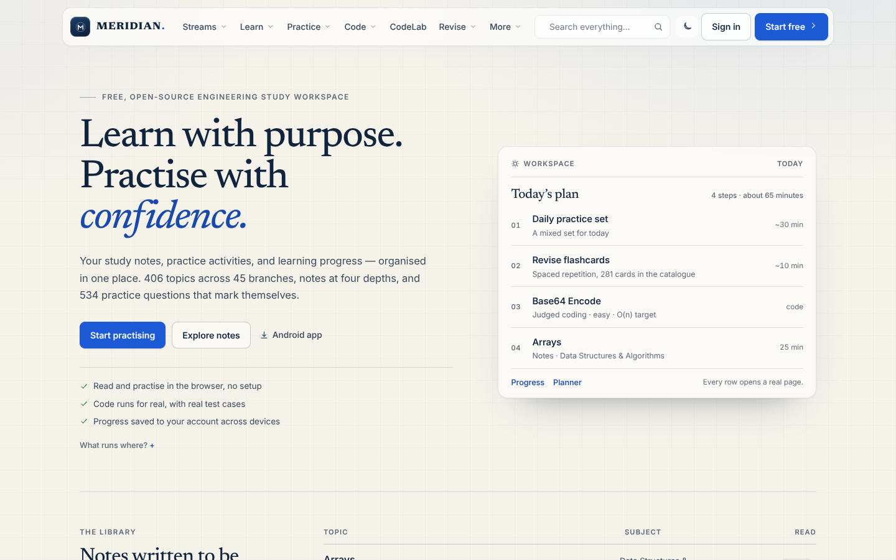
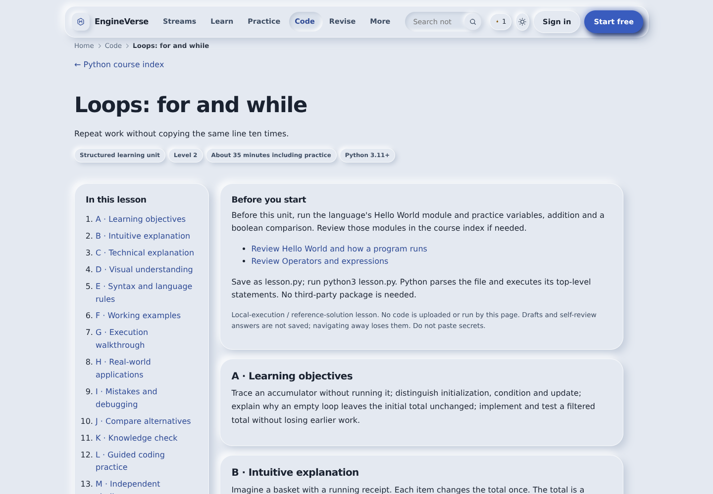
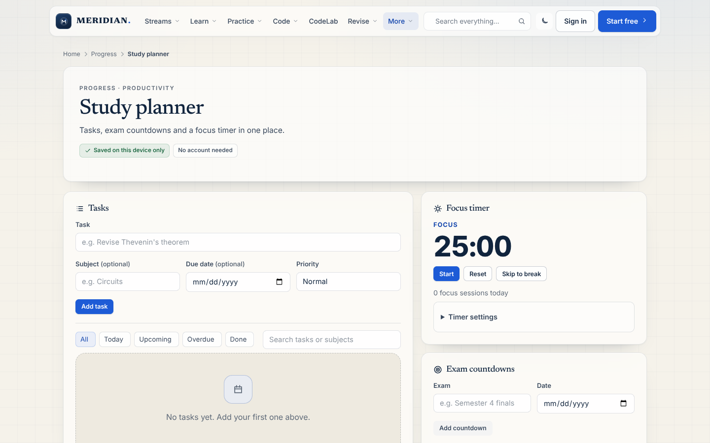
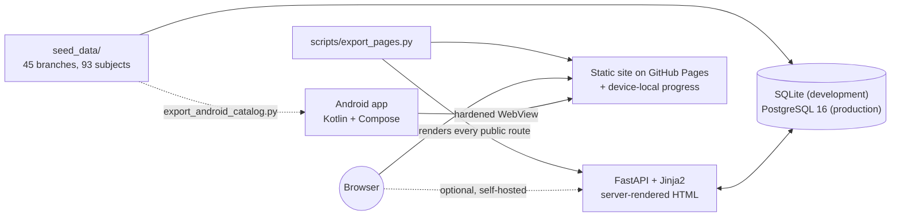

<h1 align="center">Meridian</h1>

<p align="center">
  <strong>Engineering, studied properly.</strong><br>
  A free, open-source study workspace for engineering students.
</p>

<p align="center">
  <a href="https://github.com/sauravprivatelimited369-byte/Engine_Verse/actions/workflows/ci.yml"></a>
  <a href="https://github.com/sauravprivatelimited369-byte/Engine_Verse/actions/workflows/pages.yml"></a>
  <a href="https://github.com/sauravprivatelimited369-byte/Engine_Verse/actions/workflows/android-build.yml"></a>
  <a href="https://github.com/sauravprivatelimited369-byte/Engine_Verse/actions/workflows/java.yml"></a>
  
  
  
</p>

<p align="center">
  <a href="https://sauravprivatelimited369-byte.github.io/Engine_Verse/"><strong>Open the live site →</strong></a>
</p>

<p align="center">
  
</p>

<p align="center">
  
  
</p>

<p align="center">
  <sub>Live captures of the running application (headless Chromium, 1440×900). The visual identity is documented in <a href="docs/BRAND.md">docs/BRAND.md</a>.</sub>
</p>

---

## What this is

Meridian is a study workspace built for engineering students: read a topic at the
depth you need, practise it, write real code against real compilers, revise on a
schedule, and see what you have actually completed.

It is one codebase that ships three ways. The same catalogue, the same seed data
and the same tests back all of them.

| | What it is | Accounts | Where your progress lives |
|---|---|---|---|
| **[Website](https://sauravprivatelimited369-byte.github.io/Engine_Verse/)** | A static copy rendered from the FastAPI app and deployed by Actions | None | Your browser (export and import as JSON) |
| **Android app** | Native Kotlin with an offline catalogue, planner and progress | None | The app's private storage |
| **Self-hosted site** | The full FastAPI application with accounts, PostgreSQL and an optional server judge | Yes | Your server's database |

> **Name note.** The product is **Meridian**; the repository, the Python package
> (`engineverse`) and the `ENGINEVERSE_*` settings keep the original codename, so
> a rebrand never breaks an import path, a stored format or an existing
> deployment. [docs/BRAND.md](docs/BRAND.md) records the naming rationale.

## At a glance

Every number below was produced on this commit by
`python scripts/seed.py --fresh --no-demo --stats`.

| Catalogue | Practice | Code | Verification |
|---|---|---|---|
| 45 branches · 93 subjects | 534 questions · 107 daily sets | 105 judged problems · 14 sheets | 1,982 tests · 6 CI workflows |
| 406 topics · 1,624 notes | 281 flashcards (SM-2) | 10 language paths · 225 modules | 1,138 pages exported |
| 10,556 note sections · 365 formulas | 17 projects · 5 roadmaps | 12 CodeLab runtimes | 64 + 29 jsdom browser checks |

## Contents

- [What this is](#what-this-is) · [At a glance](#at-a-glance)
- [Design principles](#design-principles)
- [Features](#features)
  · [Learning catalogue](#learning-catalogue)
  · [Practice and revision](#practice-and-revision)
  · [Code execution](#code-execution)
  · [Planning, progress and community](#planning-progress-and-community)
  · [Listening and speaking](#listening-and-speaking)
  · [Study assistant](#study-assistant)
  · [Engineering and developer labs](#engineering-and-developer-labs)
- [Architecture](#architecture) · [Repository map](#repository-map)
- [Getting started](#getting-started)
- [Tests and checks](#tests-and-checks)
- [Deployment](#deployment)
- [Android app](#android-app)
- [Security and privacy](#security-and-privacy)
- [Scope and limitations](#scope-and-limitations)
- [Documentation](#documentation)
- [Contributing](#contributing) · [Licence](#licence) · [Acknowledgements](#acknowledgements)

## Design principles

These are enforced, not aspirational — each one has a test or a CI gate behind it.

1. **No pretend features.** A control either works or is not shown. A runtime that
   is missing reports *not run* with the reason; the assistant page says it is not
   connected instead of showing a chat box that cannot answer.
2. **Claims are tested.** The navigation table is asserted against the running app,
   every exported page is checked for a valid heading outline and working internal
   links, and real programs are compiled and run in every browser language before
   the site deploys.
3. **No third-party runtime.** No CDN, no analytics, no JavaScript build step, no
   third-party scripts. Fonts are self-hosted (SIL OFL) and CI fails if a CDN host
   appears in a template or a static asset.
4. **Say what runs where.** The static copy, the self-hosted app and the Android app
   have different capabilities, and the interface states which one you are using
   rather than blurring them together.

## Features

| Area | What it does | Static copy | Self-hosted |
|---|---|---|---|
| **Learn** | 45 branches, 93 subjects, 406 topics; notes at four reading depths, 406 diagrams, 406 interactive 3D models, 365 formulas, 400 videos and 395 books | ✓ | ✓ |
| **Practise** | 534 questions, 107 daily problem sets, a mistake notebook and 281 revision flashcards | ✓ progress in the browser | ✓ progress in your account |
| **Code** | 105 judged problems in 14 sheets, 10 staged language paths and the CodeLab workspace | ✓ real compilers in WebAssembly | ✓ server judge or Judge0 |
| **Plan** | Study planner with tasks, priorities, exam countdowns and a focus timer | ✓ device-local | ✓ |
| **Track** | Dashboard, streaks, a heatmap and a portfolio of completed work | ✓ | ✓ across devices |
| **Explore** | Internships, scholarships, olympiads and hackathons, linked to official pages | ✓ | ✓ |
| **Listen** | Device voices read notes, formulas, roadmaps and tutor answers; optional ElevenLabs voice | ✓ device voice | ✓ device voice or ElevenLabs |
| **Assist** | An n8n-backed study assistant, as a launcher and a full page | ✓ when configured | ✓ when configured |
| **Community** | Threads, comments, votes, reports, certificates and a leaderboard | Read-only | ✓ |

### Learning catalogue

The catalogue is data, not markup: pages enumerate whatever the database holds, so
a deployment seeded with less shows less.

- **Four real reading depths.** Beginner, standard, advanced and industry are
  assembled from different sections of the same authored material — not the same
  text with a different label. A standard note uses the
  [13-section template](docs/NOTE_TEMPLATE.md) (definition, intuition, formula,
  derivation, worked example, applications, common mistakes, exam and interview
  questions, diagram, industry use).
- **Diagrams and 3D models.** 406 topic-linked SVG diagrams and 406 interactive
  models rendered by a dependency-free WebGL renderer
  (`backend/static/js/engine3d.js`: mesh builders, Phong shading, orbit controls).
  Every stored scene is built by the shipped renderer in CI.
- **Ten programming paths.** Python, Java, JavaScript, TypeScript, C, C++, C#, Go,
  Rust and SQL, staged as *Foundations → Working practice → Advanced engineering*
  across 30 stages and 225 modules, each stage ending in three checkpoint
  questions.
- **Honest coverage.** Topics that have not been expert-reviewed are labelled as
  drafts, and the academy pages state how many modules have structured units
  (`2 of 35` for Python, for example) rather than implying a finished textbook.
  [docs/CURRICULUM_COVERAGE.md](docs/CURRICULUM_COVERAGE.md) is generated from a
  database, not written by hand.

### Practice and revision

- **Daily problem sets.** 107 published sets (535 slots) mixing question types;
  a fixed archive is seeded so the page is never empty on a fresh install.
- **XP only on first success.** A question pays on its first correct answer and a
  coding problem on its first accepted solution; repeats and wrong answers pay
  nothing. Attempts are still recorded — history, mistake notebook, streaks.
- **Spaced repetition.** SM-2 scheduling over 281 public flashcards, with a due
  queue surfaced in the interface.
- **Projects and roadmaps.** 17 project briefs with ordered steps, skills and
  resources (98 steps), 5 roadmaps and 57 nodes.
- **A retrieval-grounded tutor** that composes answers from Meridian's own indexed
  material, cites its sources, and says when the catalogue has no coverage. It
  makes no external model call by default.

### Code execution

Learner code is untrusted, and the two deployments run it in completely different
places. Both are real compilers — nothing is simulated.

**On the static copy and in the Android app**, code runs in the browser inside a
Web Worker, with each runtime fetched lazily the first time its language is picked
and served same-origin from the repository:

| Language | Runtime in the browser |
|---|---|
| Python | CPython 3.12 via Pyodide 0.26.4 (~13 MiB) |
| C, C++ | Clang 22 compiled to WebAssembly |
| Java | OpenJDK `javac` with the TeaVM AOT compiler |
| C# | Roslyn on Blazor WebAssembly |
| TypeScript | The official TypeScript compiler, fully type-checking |
| Go | GopherJS |
| Rust | `rustc`'s Miri interpreter on WebAssembly |
| SQL | SQLite compiled to WebAssembly (sql.js) |
| Shell | A POSIX `sh` interpreter in the browser |
| JavaScript | An isolated Web Worker |

That is about **170 MiB across all languages**, downloaded only when used. The Pages
workflow compiles and runs a real program in every language — passing stdin wherever
the runtime supports it — before deploying. Two platform limits are labelled instead
of hidden: Go cannot read stdin in the browser, and the Rust worker wraps snippets
that lack `fn main`. A runtime whose files failed to download is omitted from the
manifest and reports *not run*.

**On a self-hosted site**, the server judge is opt-in. Production defaults to
`ENGINEVERSE_JUDGE=disabled`; an operator may configure a separately managed Judge0
endpoint. The development judge (`auto`) runs a child process with resource limits,
private namespaces and a scrubbed environment, and it is explicitly **not** a
container boundary — which is why production refuses it. See
[docs/SECURITY.md](docs/SECURITY.md) and [deploy/README.md](deploy/README.md).

### Planning, progress and community

- **Planner:** tasks with subject, due date and priority; overdue, today and
  upcoming views; exam countdowns; a 25-minute focus timer with breaks.
- **Progress:** XP, levels, streaks, a year heatmap, badges and a portfolio of
  completed topics and problems.
- **Study hub:** every branch has a stream page gathering the subjects, notes,
  formula sheets, flashcards, sheets and projects that branch actually has, with
  counts read from the database.
- **Community** (self-hosted only): threads, comments, votes and reports with
  per-account rate limits and RBAC.

### Listening and speaking

Tap **Listen** beside a note, formula, roadmap, tutor answer or assistant reply —
or **Listen to all sections** on a long lesson. This uses a voice installed in your
browser or device, so it works on the static copy with no backend and no API key.
Pause, resume and stop work mid-lesson, and the reader says so when a browser has
no speech engine instead of offering a dead button.

On `/tutor`, browsers that support speech recognition also offer **Ask by voice**.
The microphone is never requested on load, and typed answers are not read aloud
automatically. A natural ElevenLabs voice and a live voice agent are opt-in and
require a self-hosted backend; the key never reaches the browser. Setup, privacy,
cost controls and limits are in
[docs/ELEVENLABS_INTEGRATION.md](docs/ELEVENLABS_INTEGRATION.md).

### Study assistant

`/assistant` is an AI assistant backed by an n8n **Chat Trigger**, with a floating
launcher on every page. It is off by default and says so.

- **Self-hosted:** the browser posts to `/api/assistant/chat`, which forwards to
  n8n. The webhook URL never reaches the browser, so the CSP stays
  `connect-src 'self'` and n8n can live on a private network.
- **Static copy:** there is no server, so the browser calls the Chat Trigger
  directly — only when the repository variable
  `ENGINEVERSE_ASSISTANT_PUBLIC_URL` is set and the workflow allows the Pages
  origin.
- **Honest by construction:** answers are labelled AI-generated, the page lists what
  the assistant cannot do, no transcript is stored by Meridian, and the audit log
  keeps character counts rather than questions.
- **Bounded:** 2–800 characters per question, plus per-IP, per-session and per-budget
  limits inside the workflow. Timeouts, 429s and outages become a sentence a student
  can act on, with a retry.

Eight importable workflows live in [`n8n/workflows/`](n8n/workflows) — student
copilot (HTTP-model and agent variants), feedback intake, content drafting with a
mandatory human review stop, onboarding, unsubscribe, analytics rollup and
operations monitoring. They import inactive with placeholder credentials; the manual
steps are in [docs/N8N_AUTOMATION.md](docs/N8N_AUTOMATION.md).

> **Not verified in this repository:** a message sent to the owner's n8n Cloud
> workspace. The transport is tested against a local server that implements the
> Chat Trigger contract ([`scripts/mock_n8n.py`](scripts/mock_n8n.py)), and
> [`scripts/verify_assistant.py`](scripts/verify_assistant.py) sends one real
> message once a URL is configured.

### Engineering and developer labs

Four capabilities are wired into the catalogue and navigation. On the static copy
they show the data, blueprints and JSON downloads with clearly labelled examples;
the controls that would need a server are disabled rather than pretending to run.

| Lab | What it does |
|---|---|
| **Public APIs** (`/apis`) | 12 curated developer and engineering APIs with auth, CORS, search and runnable cURL/Python/JavaScript examples |
| **Data & BaaS studio** (`/studio`) | A five-service comparison, a 26-table schema inspector, an access-policy matrix and a bounded `SELECT` runner against a **disposable public snapshot** |
| **Workflow automations** (`/workflows`) | Declarative study, revision and placement pipelines with real streamed step outputs and importable n8n JSON; no user code executes |
| **Engineering swarm** (`/swarm`) | Five deterministic review lenses over seeded content, with citations, and trade-offs left explicitly unresolved |

See [docs/ADVANCED_CAPABILITIES.md](docs/ADVANCED_CAPABILITIES.md) for endpoint
contracts, isolation limits and grounding guarantees.

## Architecture

One deployable unit: a Python web application over a SQL data layer, plus an
optional separate JVM process for executing learner code. No message broker, no
search service, no CDN, no SaaS dependency.



**Server-side rendering, progressively enhanced.** Every page is HTML from Jinja2.
There is no client bundle to build and no hydration step; `app.js` is one
dependency-free file that adds search suggestions, the code editor, flashcard
flipping and the PWA install prompt. With JavaScript disabled the site still reads
and still works. A web app manifest and a service worker make it installable on a
phone without an app store.

**One process, one database.** A learning platform is dominated by reads of content
that changes rarely. Services in `engineverse/` never import from `web/`, and the
data layer sits behind `engineverse/db.py`, so extracting a service later is a
refactor rather than a rewrite.

**SQL, not an ORM.** Queries are explicit SQL in the service modules, so the query
that runs is the query you can read. `db.py` translates `?` placeholders to `%s` for
PostgreSQL — the only dialect difference the rest of the codebase sees.

**Navigation is data.** [`engineverse/navigation.py`](backend/engineverse/navigation.py)
holds one ordered table of 50 destinations in 9 groups. The desktop top bar, the
mobile bar, the footer columns, the breadcrumbs, `/resources`, `/sitemap.xml` and
the Pages export list are all derived from it, so they cannot disagree about what
exists or what it is called. Tests check the table's audience flags against what the
application actually does.

The full module map, the request lifecycle (CSP nonce → rate limit → CSRF → router)
and the reasoning behind both are in
[docs/ARCHITECTURE.md](docs/ARCHITECTURE.md).

## Repository map

```text
Engine_Verse/
├── backend/
│   ├── main.py                  ASGI app: security headers, CSP nonce, rate limits, CSRF
│   ├── engineverse/             the domain layer — catalogue, practice, coding, SRS, tutor,
│   │   │                        voice, community, search, progress, navigation, branding
│   │   ├── security/            passwords (scrypt), sessions (HMAC), CSRF, RBAC, TOTP, rate limits
│   │   └── judge/               execution providers: local, Java bridge, Judge0
│   ├── web/                     routers: server-rendered pages, JSON API, auth, voice
│   ├── templates/               84 Jinja2 templates
│   ├── static/                  CSS, self-hosted fonts, 14 JS files, icons, service worker
│   └── tests/                   45 test modules, 1,982 tests
├── seed_data/                   the curated catalogue as Python data (~39k lines)
├── scripts/                     45 operator and CI scripts (seed, export, verify, back up)
├── db/                          SQLite schema + generated PostgreSQL schema
├── deploy/                      Dockerfile, Compose topology, Caddy overlay, backups
├── android/                     standalone Gradle project: Kotlin + Jetpack Compose
├── sandbox-java/                the JVM sandbox used by the development judge
├── n8n/workflows/               8 importable automation workflows
├── docs/                        24 documents: architecture, security, brand, deployment, audits
└── .github/                     6 workflows, issue forms, pull request template, Dependabot
```

## Getting started

**Requirements**

| Tool | Version | Needed for |
|---|---|---|
| Python | 3.11 or newer | The web application and every check |
| Node.js | 22 | The browser-side checks (jsdom) |
| JDK 17 + Android SDK 36 | — | The Android app only |
| Docker Compose | v2 | A containerised deployment only |

**Run it locally**

```bash
git clone https://github.com/sauravprivatelimited369-byte/Engine_Verse.git
cd Engine_Verse

python -m venv .venv && . .venv/bin/activate      # Windows: .venv\Scripts\activate
python -m pip install -r requirements.txt

cp .env.example .env
python -c "import secrets; print(secrets.token_hex(32))"   # paste into ENGINEVERSE_SECRET

python scripts/seed.py --fresh --no-demo           # --fresh wipes the development database
uvicorn main:app --app-dir backend --host 0.0.0.0 --port 8000 --reload
```

Open <http://127.0.0.1:8000> and register. To create a super administrator:

```bash
python scripts/create_admin.py                     # reads ENGINEVERSE_ADMIN_PASSWORD or prompts
```

Omit `--no-demo` if you want the five development accounts the seeder otherwise
creates. They are refused in production and their passwords are printed only in
development.

**Three settings worth knowing**

| Variable | Default in `.env.example` | Effect |
|---|---|---|
| `ENGINEVERSE_SIGNIN` | `required` | `required` puts every page behind an account; `optional` allows anonymous browsing of the public catalogue |
| `ENGINEVERSE_LOGIN_OTP` | `disabled` | `signup_only` or `required` add delivered six-digit codes and need an SMTP or SMS transport |
| `ENGINEVERSE_JUDGE` | `auto` | Development judge selection; production accepts only `disabled` or `judge0` with a URL |

**Build the static copy locally**

```bash
python scripts/export_pages.py --out site --reading-copy
python scripts/fetch_pyodide.py --out site/pyodide              # optional: Python in the browser
python scripts/fetch_browser_runtimes.py --out site/runtimes    # optional: the other languages

mkdir -p /tmp/serve && ln -sfn "$PWD/site" /tmp/serve/Engine_Verse
python -m http.server 8765 --directory /tmp/serve   # http://127.0.0.1:8765/Engine_Verse/
```

The exporter renders 1,138 pages, rewrites every link for the `/Engine_Verse/` base
path, omits the routes that cannot work without a server, and refuses to publish a
demo password or a token. It also reports broken internal links and heading outlines
as it goes.

## Tests and checks

Run everything from the repository root, as CI does.

| Command | What it covers |
|---|---|
| `python -m pytest backend/tests -q` | **1,982 tests**, about 9 minutes (1,980 passed, 2 skipped on this checkout) |
| `python -m pytest backend/tests -q -m "not slow"` | Skips tests that really compile and run code |
| `node scripts/check_static_site.js site` | **64 checks** on the exported pages under jsdom: device-local progress, export/import validation, honest pages, no dead links |
| `node scripts/check_assistant.js site` | **29 checks**: launcher, chat contract, error and retry states, Esc, offline mode, HTML escaping |
| `node scripts/check_voice.js` | **123 checks** on the voice reader and spoken tutor, with the backend stubbed |
| `node scripts/check_planner.js site/planner/index.html site/static/js/planner.js` | The planner end to end |
| `python scripts/check_n8n_workflows.py` | Structure and embedded JavaScript of all 8 n8n workflows |
| `python scripts/check_links.py` | Every external resource URL (weekly, non-blocking) |
| `python scripts/export_android_catalog.py --check` | The Android catalogue matches the seed data |
| `cd android && ./gradlew testDebugUnitTest lintDebug assembleDebug` | The Android app (JDK 17 + SDK 36) |

The first browser check needs `npm install --prefix .toolchain/jsdom jsdom@26`
once. Tests that need a compiler or a kernel namespace skip themselves with an
explicit reason rather than passing silently.

**Continuous integration** — six workflows:

| Workflow | Trigger | What it does |
|---|---|---|
| [CI](.github/workflows/ci.yml) | Every push, every pull request, plus a weekly schedule | Python suite on SQLite; a real PostgreSQL first boot; JavaScript syntax, 3D maths and every stored scene; export and jsdom checks; weekly external links |
| [GitHub Pages](.github/workflows/pages.yml) | Push to `main` | Tests, export, runtime download, a real program run per language, jsdom checks, a secret scan, deploy — then `verify_pages.py` against the live URL and the exact commit |
| [Android app](.github/workflows/android-build.yml) | Changes under `android/` | Unit tests, lint, a debug APK artifact; a signed release only on manual dispatch |
| [Java sandbox](.github/workflows/java.yml) | Changes to `sandbox-java/` | Build and test on JDK 21 and 25 |
| [Public credential scan](.github/workflows/public-credential-scan.yml) | Daily | Looks for credential material in public issues and pull requests without printing matches |
| [Redact public issue](.github/workflows/redact-public-issue.yml) | Manual | Owner-operated incident tool; refuses to write unless the issue actually contains a digest |

A green suite is a regression guard, not a security audit and not a certification of
any deployment.

## Deployment

**GitHub Pages — the static copy.** `pages.yml` builds, verifies and deploys on
every push to `main`; the site is served under `/Engine_Verse/`. Enable it once in
**Settings → Pages → Source: GitHub Actions**. Nested routes are exported as
`route/index.html`, and a `404.html`, `sitemap.xml` and `robots.txt` are generated.
Pages cannot run Python, so accounts, the server judge and the database are not part
of this copy — and the interface says so.

**Self-hosted — the full application.** Docker Compose with automatic TLS on your
own domain:

```bash
cp deploy/.env.example deploy/.env    # set ENGINEVERSE_SITE_URL, ENGINEVERSE_SECRET and the database passwords
docker compose --env-file deploy/.env -f deploy/docker-compose.yml -f deploy/public.yml up -d --build
python scripts/verify_hosted_app.py --url https://your-domain
```

The topology is four services: a one-shot `release` step (migrate, seed only when
empty, grant the runtime role), the non-root `web` process with a read-only root
filesystem, PostgreSQL 16 on an internal network, and a local backup client. Caddy
provides the public HTTPS edge in the overlay; the database port is never published.

Production refuses to boot with a weak or development secret, a non-HTTPS site URL,
SQLite, a local code judge, or sign-in codes that have no transport. Once the hosted origin is live,
setting the Actions variable `ENGINEVERSE_APP_URL` turns the Pages site into a
gateway to it — `verify_pages.py` then checks that mode too.

Read [docs/DEPLOYMENT.md](docs/DEPLOYMENT.md), [deploy/README.md](deploy/README.md),
[docs/BACKUPS.md](docs/BACKUPS.md) and
[GLOBAL_DEPLOYMENT.md](GLOBAL_DEPLOYMENT.md) before running a public instance.

## Android app

[`android/`](android/README.md) is a standalone Gradle project — native Kotlin with
Jetpack Compose (AGP 9.4.1, Gradle 9.4.1, Compose BOM 2026.09.00, minSdk 24,
targetSdk 36, JDK 17).

- **Works offline:** the bundled catalogue (93 subjects, 406 topics), progress and
  streaks, the planner, the portfolio and settings.
- **Opens the website for the rest:** full notes and CodeLab load in a hardened
  in-app viewer that accepts only this site over HTTPS, exposes no JavaScript bridge,
  blocks mixed content, disables file and content access, and never bypasses a TLS
  error.
- **No accounts, analytics or ads.** Progress lives in one private
  `SharedPreferences` file; the app requests only `INTERNET` and
  `ACCESS_NETWORK_STATE`.

Every Android change uploads a debug APK (`engineverse-debug-apk`) and its SHA-256
to the [workflow run](https://github.com/sauravprivatelimited369-byte/Engine_Verse/actions/workflows/android-build.yml).
The debug APK is for testing; a signed release needs the maintainer's keystore in
repository secrets. No signed APK has been published yet, and the app is not on
Google Play.

## Security and privacy

**On the static copy and in the app:** no accounts, no analytics, no ads. Progress
stays on your device; nothing you type is uploaded, and imported files are validated
field by field.

**On a self-hosted instance:**

- Passwords are hashed with **scrypt** (`N=16384, r=8, p=1`), with NFKC normalisation,
  a 256-character cap and constant-time comparison.
- Sessions are opaque tokens stored only as **HMAC-SHA-256 digests**, in `HttpOnly`,
  `SameSite=Lax` cookies that are `Secure` over HTTPS.
- Every state-changing request needs a **CSRF** token bound to the session or an
  anonymous browser cookie.
- Rate limits are applied per route — sign-in, registration, reset links, practice
  answers, code run/submit, tutor and the API — plus per-account budgets for
  sensitive settings.
- **CSP with a per-request nonce** and `connect-src 'self'`, alongside X-Frame-Options,
  nosniff, Referrer-Policy, Permissions-Policy, COOP/CORP and HSTS.
- TOTP two-factor sign-in is available per account; delivered codes are optional and
  require a configured transport.
- The container runs non-root with a read-only root filesystem, all capabilities
  dropped and `no-new-privileges`. The runtime database role cannot `CREATE TABLE`.
- No secrets, keystores, dumps or learner data are committed, and CI refuses to
  publish demo passwords or tokens.

To report a vulnerability, follow
[docs/SECURITY.md](docs/SECURITY.md#reporting-a-vulnerability) — please do not open a
public issue. The threat model and every control are documented there.

## Scope and limitations

Written down because a README that hides these is not worth trusting.

- **The catalogue is starter coverage, not a degree.** Many generated topics are
  still marked for expert review, and most language modules use the legacy lesson
  format. Meridian is not an accredited institution and its certificates are records
  of completion.
- **Progress does not sync between devices** on the static copy or in the app. Use
  export/import, or self-host the full site. The website and the app keep separate
  progress by design.
- **The browser runtimes are large** — about 13 MiB for Python and up to about 170 MiB
  across all languages, each loaded only when first used. Go cannot read stdin in the
  browser.
- **The server's local runner is not a container boundary.** Production refuses it;
  isolation of a Judge0 deployment is the operator's responsibility.
- **In the Android viewer**, the site's download and export buttons cannot save files
  because they create blob URLs. They say so and offer *Open in browser*.
- **The assistant needs its own configuration and budget.** Every message costs one
  n8n execution plus one model call; without a configured Chat Trigger it reports
  that it is not connected.
- **Opportunity deadlines change.** Meridian links to official pages and does not copy
  dates; a weekly CI job checks that the links still resolve.
- **There is no versioned web release yet.** The changelog tracks everything under
  *Unreleased*; the Android app carries its own version (`1.0.0`).

## Documentation

| Start here | What it covers |
|---|---|
| [Features in depth](docs/FEATURES.md) | Every capability, with operational detail |
| [Architecture](docs/ARCHITECTURE.md) | Module map, request lifecycle, navigation, design decisions |
| [Security](docs/SECURITY.md) | Threat model, controls, reporting |
| [Deployment](docs/DEPLOYMENT.md) · [deploy/](deploy/README.md) · [Backups](docs/BACKUPS.md) | Running a public instance and keeping it recoverable |
| [Android app](android/README.md) · [PWA/TWA](docs/ANDROID_TWA.md) | The native app and store packaging |

| Reference | What it covers |
|---|---|
| [Study assistant](docs/ASSISTANT.md) · [n8n automation](docs/N8N_AUTOMATION.md) | Configuration, credentials, costs, manual steps |
| [ElevenLabs integration](docs/ELEVENLABS_INTEGRATION.md) | Voice reader and spoken tutor, privacy and cost limits |
| [Brand](docs/BRAND.md) · [Content policy](docs/CONTENT.md) · [Note template](docs/NOTE_TEMPLATE.md) | Naming, design system, licensing rules, note format |
| [Academy](docs/ACADEMY.md) · [Coverage](docs/CURRICULUM_COVERAGE.md) · [Outcomes](docs/LEARNING_OUTCOMES.md) | Programming curriculum scope and generated coverage |
| [Labs](docs/ADVANCED_CAPABILITIES.md) · [Growth](docs/GROWTH.md) | APIs, studio, workflows, swarm; SEO and measurement |
| [Audits](docs/AUDIT_2026-10-18.md) · [Incident response](docs/INCIDENT_RESPONSE.md) | Past audits, findings and the incident runbook |
| [PostgreSQL schema](db/postgres/README.md) · [Java sandbox](sandbox-java/README.md) | Database design and the JVM runner |
| [Changelog](CHANGELOG.md) | What changed, and why |

## Contributing

Corrections to notes are as welcome as code. Before you start:

- Read [CONTRIBUTING.md](CONTRIBUTING.md) and the
  [Code of Conduct](CODE_OF_CONDUCT.md).
- Open an issue for anything larger than a fix. There are forms for
  [bugs](.github/ISSUE_TEMPLATE/bug_report.yml),
  [features](.github/ISSUE_TEMPLATE/feature_request.yml) and
  [content corrections](.github/ISSUE_TEMPLATE/content_correction.yml).
- Keep the project honest: no pretend features, no committed secrets or learner data,
  link rather than copy third-party material, and keep the "what runs where" labels
  accurate.
- Add tests, update the docs and add a line to [CHANGELOG.md](CHANGELOG.md) under
  **Unreleased**. CI must pass.

The fastest useful contribution is a wrong formula, a broken example or a dead link
reported against the page it appears on.

## Licence

Released under the [MIT Licence](LICENSE). © 2026 sauravprivatelimited369-byte and
EngineVerse contributors.

Third-party books, videos and articles are **linked, not copied** — see
[docs/CONTENT.md](docs/CONTENT.md). Bundled fonts (Newsreader, Inter, Sora) are SIL
OFL and ship with their licence files in `backend/static/fonts/`. Browser
runtimes are fetched at build time from their published npm packages and keep
their own licences in the generated `site/runtimes/` tree.

## Acknowledgements

Meridian stands on work that is itself open: Pyodide (CPython in WebAssembly),
Clang, the TeaVM project, GopherJS, Miri, Roslyn and Blazor, SQLite, and the
maintainers of the `@live-codes` WebAssembly toolchains. The labs in `/apis`,
`/studio`, `/workflows` and `/swarm` were inspired by
[public-apis](https://github.com/public-apis/public-apis), Supabase, Appwrite, n8n
and MiroFish respectively, and say so on the pages themselves.

And to the students who report a formula that does not come out right: that is the
most valuable pull request this project receives.
