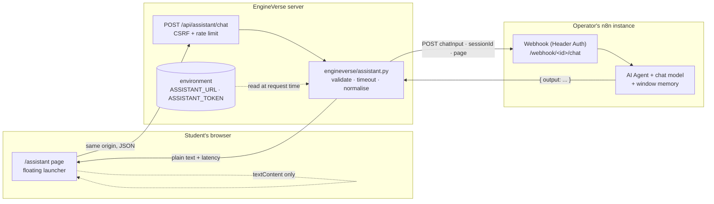

# The AI student copilot (n8n integration)

EngineVerse has two different answer surfaces, and confusing them is the easiest
way to make a study tool dishonest:

| | `/tutor` — study tutor | `/assistant` — AI copilot |
|---|---|---|
| Where answers come from | EngineVerse's own indexed notes, formulas and topics | The operator's n8n AI workflow and its model |
| What happens when the catalogue has nothing | It says so and cites nothing | The model answers, or says it does not know |
| External calls | None | One, server-side, to the configured workflow |
| Labelled | "Generated from this platform's own notes" | "AI workflow · not a human · answers can be wrong" |
| Available on GitHub Pages | Yes (browser copy) | No — there is no server to forward a question |

The copilot is **optional**. With `ENGINEVERSE_ASSISTANT_URL` empty the page
renders an explanation, the floating launcher is not created, and every other
feature works exactly as before. Nothing in this repository pretends a workflow
is connected when it is not.

## Architecture



The browser never contacts n8n. That is deliberate:

- **CSP.** `backend/main.py` sends `script-src 'self'`, `connect-src 'self'` and
  `frame-src 'none'`. The official `@n8n/chat` widget is a third-party script
  that posts cross-origin and, in hosted-chat mode, may be framed. Loading it
  would require relaxing all three directives on every page.
- **Secrets.** The webhook URL identifies the workflow. Putting it in client
  source publishes it; the n8n instance would then need its own CORS and
  authentication rules for every origin on the internet.
- **Server-side limits.** Size, character set, session shape, timeout and
  duplicate-submission rules are enforced once, in Python, where they can be
  tested. `backend/tests/test_assistant.py` exercises them.

The cost of this design is one extra hop (a few milliseconds on a LAN, more if
the n8n instance is on another continent). It is the right trade for a page that
students paste error messages into.

### Why the hosted chat page is not embedded

`https://authorsauravkushwaha.app.n8n.cloud/assistant` is a **hosted chat
interface**, not an embeddable endpoint. A hosted chat page is not a webhook: it
carries its own authentication and its own framing policy, and the URL cannot be
turned into a chat API by putting it in an iframe. Embedding it inside EngineVerse
would also put a third-party frame on a page whose CSP is `frame-src 'none'`, and
would send students to a separate origin with no EngineVerse context.

That page was **not reachable from the environment where this work was done**
(outbound access is restricted to package registries and GitHub), so this
document makes no claim about whether it allows framing or CORS. The
integration uses the documented n8n webhook contract instead, which works
whether or not the hosted page is public.

## What was verified, and what was not

Be precise about this:

| Claim | Status |
|---|---|
| The bridge validates input, enforces limits, times out and normalises replies | **Verified** — `backend/tests/test_assistant.py` (37 tests) |
| A question reaches an HTTP webhook and the answer returns to a browser session through the app | **Verified against a local stand-in webhook** started on loopback by the test suite — not against the operator's n8n instance |
| The page, launcher, error states and rate limiter behave as documented | **Verified** in the test suite and the exported static site checks |
| The operator's actual n8n workflow returns a reply | **Not verified** — no credentials for that instance and no outbound access to it from the build environment |
| n8n imports the template JSON without a version prompt | **Not verified** — only the JSON shape is tested (`test_n8n_automation.py`) |

To close the last two rows, the operator runs one command after configuring the
workflow (see below). Until it exits 0, the honest description is "configured,
not yet answered".

## Configuration

All values live in the server's environment. None of them is rendered into a
page or written to a log.

| Variable | Required | Purpose |
|---|---|---|
| `ENGINEVERSE_ASSISTANT_URL` | yes, to enable | Production webhook URL of the workflow, e.g. `https://YOUR-N8N-HOST/webhook/<webhook-id>/chat`. Must be `https` in production; must not contain credentials. |
| `ENGINEVERSE_ASSISTANT_TOKEN` | usually | Shared secret sent in the header below. Store it in the host's secret manager, never in Git. |
| `ENGINEVERSE_ASSISTANT_AUTH_HEADER` | no | Header name for the token. Default `X-EngineVerse-Key`. For n8n's Header Auth credential, use the same name you set there. For `Authorization`, include the scheme in the token (`Bearer …`). |
| `ENGINEVERSE_ASSISTANT_TIMEOUT_S` | no | Read timeout for one question, 5–120 seconds. Default `45`. |
| `ENGINEVERSE_ASSISTANT_NAME` | no | Display name. Default `EngineVerse copilot`. It is never presented as a human. |

Start from [`.env.example`](../.env.example); every value there is a placeholder.
`ENGINEVERSE_ENV=production` refuses to start with a plaintext URL, a URL
containing a username/password, or an invalid header name.

### n8n setup — exact steps

These are the steps in your instance. **They have not been performed by this
change**, because the workflow is private to your account.

1. Open the workflow that powers the assistant.
2. Add (or open) a **Webhook** node. Set:
   - **HTTP Method:** `POST`
   - **Path:** `engineverse/assistant` (any unique path works; copy the result)
   - **Respond:** `Using 'Respond to Webhook' node`
   - **Authentication:** `Header Auth`, with a credential whose **Name** is
     `X-EngineVerse-Key` and **Value** a long random string.
3. Add a **Respond to Webhook** node at the end of the answering branch:
   - **Respond With:** `JSON`
   - **Response Body:** `{{ { output: $json.output } }}` (or any of `output`,
     `text`, `reply`, `answer`, `message` — the bridge understands all of them)
4. In the node panel, copy the **Production URL**. It looks like
   `https://YOUR-N8N-HOST/webhook/<id>/engineverse/assistant`. (The Test URL only
   answers while you have the editor open; do not use it.)
5. Put that URL in `ENGINEVERSE_ASSISTANT_URL` on the EngineVerse server, and the
   Header Auth value in `ENGINEVERSE_ASSISTANT_TOKEN`. Restart the web process.
6. Run the verification command below.
7. If the workflow is currently the **Chat Trigger** type rather than a plain
   Webhook, either switch to a Webhook node as above, or keep the Chat Trigger,
   set it to **Embedded Chat**, and use its production chat URL — the request
   body the bridge sends is the Chat Trigger's own
   `{ action, sessionId, chatInput }` shape.

If you prefer to import a ready-made contract, use
[`automation/n8n/01-student-copilot.json`](../automation/n8n/01-student-copilot.json)
and attach your own model credential. It contains no credential and no URL.

### Verification command

```bash
# 1. From a checkout that has the same ENGINEVERSE_ASSISTANT_* variables:
python scripts/check_assistant.py

# 2. Or against the deployed site (proves the whole path, including the proxy):
python scripts/check_assistant.py --app https://your-engineverse.example.org
```

Exit codes: `0` answered, `1` configured but failed, `2` not configured. The
script prints the host only — never the path or the token — plus the probe
question and the reply, so a human can read the answer.

## Request and response contract

The bridge sends:

```json
{
  "action": "sendMessage",
  "sessionId": "9f2c…32 hex characters",
  "chatInput": "why does my loop skip the last item?",
  "metadata": { "source": "engineverse", "page": "/codelab" }
}
```

Headers: `Content-Type: application/json`, `Accept: application/json`,
`User-Agent: EngineVerse-assistant/1.0`, and your token header when configured.
Redirects are not followed — a redirect cannot carry the token to another host.

The workflow may answer with any of these shapes; the first non-empty one wins:

```json
{ "output": "…" }
{ "text": "…" }
{ "reply": "…" }
{ "answer": "…" }
{ "data": { "output": "…" } }
[ { "text": "block one" }, { "text": "block two" } ]
```

The browser receives `{ ok, reply, sessionId, latencyMs, provider, disclosure }`.
The reply is at most 12,000 characters; longer text is truncated and labelled.
The page renders it with `textContent` and `white-space: pre-wrap`, so Markdown
appears as written text rather than formatted HTML. That is intentional:
rendering a third-party system's output as HTML is an XSS path, and a chat
widget is not worth one.

## Error states

| HTTP | `code` | What the student sees | What the operator should check |
|---|---|---|---|
| 422 | `assistant_invalid_request` | "Keep the question under 1200 characters." | Nothing; the input was refused before any network call |
| 429 | `assistant_rate_limited` | "You have asked a lot of questions… Try again in about N minute(s)." | Whether 60 questions/hour per address suits your model budget |
| 429 | `assistant_upstream_busy` | The same recovery message, using n8n's `Retry-After` | The workflow's own rate limit, or your model provider's quota |
| 502 | `assistant_unavailable` | "The assistant returned an error… try again." | Workflow is active, the production URL is correct, Header Auth matches |
| 502 | `assistant_unavailable` | The same, after a 401/403/404 from n8n | Header Auth name/value, or the webhook path and activation state |
| 503 | `assistant_not_configured` | "No AI workflow is connected to this instance." | `ENGINEVERSE_ASSISTANT_URL` |
| 504 | `assistant_timeout` | "The assistant did not answer in time." | Model latency and any slow HTTP node in the workflow |

Upstream bodies, stack traces, URLs and credentials are never returned. A 401,
403 or 404 from n8n becomes a generic 502 with an operator-facing sentence,
because telling a visitor that a credential is wrong is a hint they do not need.

## Privacy and retention

- Sent to the workflow: the question, a random per-tab session id, and the page
  path. **Not** sent: account id, username, email, IP address, cookies, learning
  history.
- EngineVerse stores **no** conversation. The transcript lives in the browser's
  `sessionStorage` for that tab only, and disappears when the tab closes or the
  student presses *New conversation*.
- The audit log records `assistant.asked` with the outcome, the question's length
  and the latency — never its text. It also records `assistant.feedback` with a
  boolean and one of five categories.
- Your n8n instance and its model provider process the question under your own
  agreement with them. The `/privacy` page says so in the student's words.
- Do not paste secrets into any chat interface. The system message tells the
  model not to repeat a password it sees; that is a mitigation, not a guarantee.

## Cost and abuse

Each question is one model call on your n8n instance. The bridge adds no cost of
its own, but it does add four protections:

1. **60 questions per hour per client address**, counted in the shared
   `api_rate_limits` table so a restart does not reset it. The `GET` status check
   is free.
2. **1,200-character** hard limit, enforced before the request leaves the server.
3. **45-second** default timeout (5–120 configurable), so a hung workflow cannot
   pin a worker thread indefinitely.
4. **No retries** on failure. A retry after a timeout could bill twice for a
   request that is still running; the student gets a *Try again* button instead.

Set the n8n workflow's own rate limit or a budget alert as well: the bridge
limits one address, not the total spend of your instance.

Two deployment notes about that limit:

- **Behind a reverse proxy**, `ENGINEVERSE_TRUST_PROXY=1` is what makes the
  "address" the real client rather than the proxy. `deploy/public.yml` already
  sets it. Without it, every student shares one 60-per-hour budget.
- On a **shared campus address**, students share the budget too. If that is your
  audience, raise `assistant` in `engineverse/security/ratelimit.py` and rely on
  the workflow's own per-session limit, rather than removing the limiter.
`automation/n8n/05-monitoring.json` alerts you when an execution fails.

## Accessibility notes

- The floating panel is a native `<dialog>`: focus trapping, Escape-to-close and
  the inert background come from the browser. The launcher exposes
  `aria-expanded` and `aria-controls`.
- The transcript is a `role="log"` with `aria-live="polite"`, so a reply is
  announced without interrupting the reader.
- Every control is a real `<button>` with text; nothing depends on an icon.
- The composer accepts Enter to send and Shift+Enter for a new line, and the
  character counter is visible.
- `prefers-reduced-motion` disables the only animation (the thinking dots).

## Troubleshooting

| Symptom | Likely cause |
|---|---|
| Page says "No AI workflow is connected" but the URL is set | The URL was rejected as invalid (plaintext in production, credentials in it, or not http/https). Check the process log for the refusal reason; the page never shows it. |
| A question returns 502 immediately | n8n returned 401/403 (Header Auth mismatch) or 404 (wrong path or inactive workflow). |
| The workflow runs but the page says "empty answer" | The workflow returned 200 without an `output`/`text`/`reply`/`answer` field. Add a Respond to Webhook node. |
| Every request times out | The workflow uses the *Test* URL, which only answers with the editor open, or an AI node has no credential. |
| Answers forget previous questions | The memory node must key on `{{ $json.body.sessionId }}` (or the value the bridge sends). A static key mixes every student together. |
| CORS errors in the browser console | Something is calling n8n directly. It should only ever call `/api/assistant/chat`. |

## Related

- [Automation workflows](N8N_AUTOMATION.md) — the n8n templates for feedback,
  onboarding, monitoring and the content pipeline.
- [Security](SECURITY.md) — the threat model this bridge sits inside.
- [Growth](GROWTH.md) — a 30-day plan that does not manufacture traffic.
