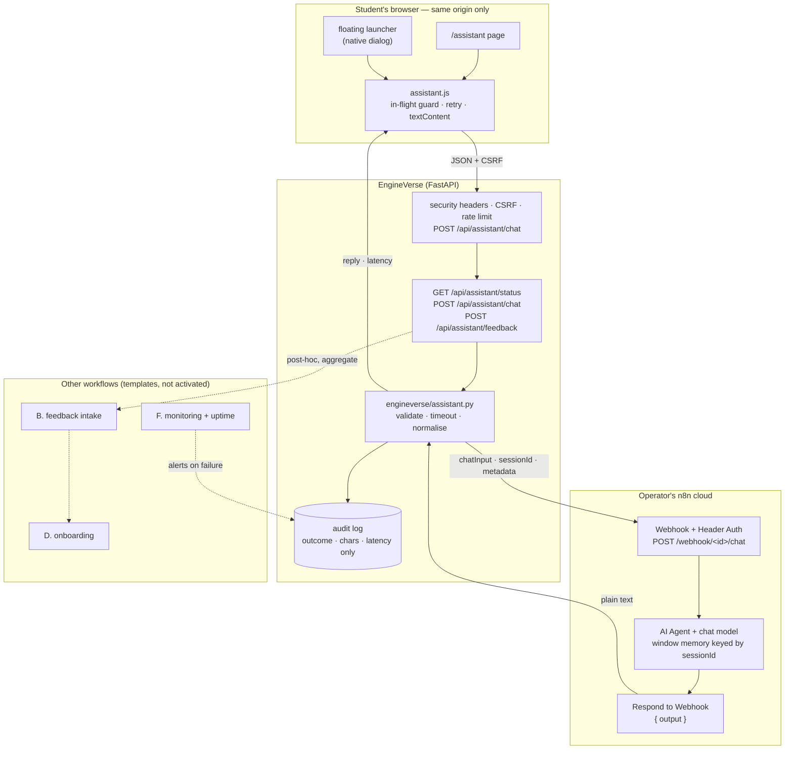

# EngineVerse × n8n — integration and platform report

- **Date:** 2026-10-23
- **Branch:** `arena/6f775e41-engine-verse` (base: `main` at `67acd09`, later merged with `affd05d`)
- **Scope:** integrate the operator's n8n AI workflow as a student copilot; audit the platform;
  improve SEO, accessibility, privacy and growth surfaces; document and verify what can be
  verified from this environment. **Nothing is deployed by this change.**
- **Rule used throughout:** every claim below names its evidence. Where evidence does not
  exist, the row says *not verified* rather than estimating.

---

## 1. Phase 1 — audit findings

The repository was audited before any code was written. It is a mature, unusually
disciplined codebase, not a starter template: the relevant finding is that **most of the
"rebuild the platform" work was unnecessary**, and the correct change was a small, isolated
integration plus targeted surface work. Existing audits and docs
(`docs/AUDIT_2026-10-18.md`, `docs/AUDIT_2026-10-19.md`) were read first.

| Question | Answer (verified in source) |
|---|---|
| Framework | FastAPI 0.151.0 + Starlette (server-rendered Jinja2), SQLite for development, PostgreSQL in production, one DB-API adapter |
| Build | **None.** No bundler, no `node_modules` requirement, no CDN. Python 3.11+ |
| Run | `uvicorn main:app --app-dir backend --port 8000`; seed with `python scripts/seed.py --fresh --no-demo` |
| Entry points | `backend/main.py` (`create_app()`), `backend/web/pages.py` (66 page routes), `backend/web/api.py` (54 JSON routes) |
| Data model | `db/schema.sql` + `db/postgres/schema.pg.sql`; seeded catalogue (branches, subjects, topics, notes, questions, DPPs, programming modules, coding problems, projects) |
| Auth | scrypt password hashes, HMAC-hashed opaque sessions, CSRF tokens, optional OTP and TOTP MFA, RBAC; auth is optional (`ENGINEVERSE_SIGNIN`) |
| Security middleware | nonce-based CSP (`script-src 'self'`), HSTS, frame denial, CSRF, per-route server-side rate limits, redacted audit log |
| Tests | 43 pytest modules; JS geometry/scene checks; a PostgreSQL schema CI job; a Java sandbox workflow |
| Public site | Static export (`scripts/export_pages.py`) to GitHub Pages with a browser-local runtime; the export is a reading copy, **not** the full app |
| CI/CD | `.github/workflows/ci.yml`, `pages.yml`, `java.yml`, `android-apk.yml`, `learner-data-sync.yml` |
| Deployment status | Pages API returns 404 from this environment and the Pages host is unreachable — **live deployment not verified** |
| Licence | MIT already present (`LICENSE`); **not changed** |

### Working, placeholder and missing — as found

- **Working:** catalogue browsing, search, practice/DPP, planner, flashcards, the retrieval
  tutor (`/tutor`), accounts and progress, the code lab with a pluggable judge, the static
  export pipeline, and the deployment compose files.
- **Deliberately disabled / optional:** code execution is `disabled` in production by default;
  the judge requires an operator-run service; sign-in is optional.
- **Placeholder or partial at the time of audit:** no AI assistant; no n8n integration; social
  sharing absent; `og:image` absent; JSON-LD absent; a stale branch name in `pages.yml`.
- **Missing but requested:** workflows A–F, assistant privacy disclosure, assistant error
  states, assistant rate limiting, verification tooling.

### Findings that shaped the design

1. **CSP is strict on purpose.** `script-src 'self' 'nonce-…'` plus `connect-src 'self'` and
   `frame-src 'none'`. Embedding `@n8n/chat` would require relaxing all three on every page
   and shipping a third-party script. Rejected.
2. **The webhook URL is a secret in practice.** It identifies the workflow. Any client-side
   integration publishes it and forces the n8n instance to accept cross-origin traffic from
   any origin. Rejected.
3. **The app already has a grounded tutor.** Adding a general AI chat needed an explicit,
   honest distinction between "answers from this platform's own notes" and "answers from an
   external model". That distinction is now in the UI, not only in the docs.
4. **Static export has no server.** The Pages copy physically cannot forward a question. The
   assistant page therefore uses a reading-copy variant instead of a dead composer.
5. **The public-credential scan rejects the n8n hostname in exported HTML.** Confirmed by
   `scripts/check_static_site.js`: `authorsauravkushwaha` is a forbidden string. A server-side
   proxy is the only design that keeps both the secret and the export clean.

---

## 2. Architecture



**Design summary:** the browser talks only to its own origin. The server validates, rate
limits, forwards one bounded request, ignores redirects, and returns plain text. The n8n URL
and token never leave the server process. There is no client-side n8n SDK, no iframe, no
websocket.

---

## 3. What was added, changed and preserved

### Added

| Area | What |
|---|---|
| Assistant page | `/assistant` — honest disclosure, suggested prompts, transcript region, composer, retry, "New conversation", character counter |
| Floating launcher | Native `<dialog>` on every page when configured; keyboard/Escape/close-button, focus restoration, no duplicate initialisation |
| Server bridge | `backend/engineverse/assistant.py` — input validation, timeout, reply normalisation, error taxonomy, audit metadata |
| JSON API | `GET /api/assistant/status`, `POST /api/assistant/chat`, `POST /api/assistant/feedback` |
| Limits | 30 questions/hour per client address on the chat route; 1000-character messages; 45 s default timeout |
| n8n templates | `automation/n8n/01…06` JSON + `feedback.sql` + README (see §5) |
| Verification | `scripts/check_assistant.py` (exit 0/1/2), `scripts/render_assistant_page.py`, `scripts/check_assistant_ui.js` (24 jsdom checks) |
| Docs | `docs/ASSISTANT.md`, `docs/N8N_AUTOMATION.md`, `docs/GROWTH.md`, this report |
| Social | Share row on topic and project pages: native share, copy link with fallback, plain WhatsApp/Telegram links |
| SEO | `og:image`, `og:image:alt`, `twitter:card`, per-page `og:description`, `WebSite` JSON-LD on the home page |
| Privacy | Assistant section in `/privacy`; support route for reporting a bad answer |

### Changed

- `base.html`: loads `assistant.css` and `assistant.js`, includes the launcher, adds social
  metadata. No inline script without a nonce; no third-party origin.
- `navigation.py`: one entry (`AI assistant` → `/assistant`) in the Learn menu. Because the
  sitemap, footer and menu all derive from that list, the page is discoverable and in the
  sitemap without duplicate edits.
- `config.py`: five `ENGINEVERSE_ASSISTANT_*` settings with production validation (https only,
  no credentials in the URL, valid header name, 5–120 s timeout).
- `ratelimit.py`, `main.py`: a dedicated `assistant` bucket, applied to the chat route.
- `legal.html`, `support.html`, `tutor.html`, `home.html`, `topic.html`, `project.html`:
  disclosure, reporting route, cross-link to the grounded tutor, and the share row.
- `pages.yml`: stale working-branch name replaced; deploy job restricted to `main`, because
  the `github-pages` environment rejects other branches after a successful build.
- `test_android_project.py`: the AGP assertion now checks the **major** version. Dependabot's
  9.1.1 → 9.4.1 bump had turned the assertion into a red main unrelated to the bump.

### Preserved

The framework, the visual language and its CSS tokens, the existing routes, the retrieval
tutor, the static-export pipeline, the security middleware, database schemas, the MIT licence,
the git history, and every existing test. No dependency was added (`httpx` was already
required); the browser ships zero new libraries.

---

## 4. Files changed, with purpose

Path → why it exists.

**Server**
- `backend/engineverse/assistant.py` — the bridge: validation, request shape, timeout, reply
  parsing, error classes, audit metadata.
- `backend/engineverse/config.py` — settings and production-time validation.
- `backend/engineverse/security/ratelimit.py` — the `assistant` bucket.
- `backend/main.py` — limiter wiring for `POST /api/assistant/chat`.
- `backend/web/api.py` — three JSON endpoints; no message body in logs.
- `backend/web/pages.py` — renders `/assistant`, supplies page-context suggestions and the
  reading-copy variant.
- `backend/web/deps.py` — template context additions used by the page and launcher.

**Front end (no build step)**
- `backend/templates/assistant.html` — full page, disclosure, unconfigured and reading-copy
  states.
- `backend/templates/_assistant_widget.html` — native `<dialog>` launcher.
- `backend/templates/_share.html` — share row, progressively enhanced.
- `backend/static/js/assistant.js` — one initialiser for both surfaces; in-flight guard,
  timeout, retry, 429 wait, status display, `textContent` rendering, per-tab session.
- `backend/static/css/assistant.css` — page, dialog, bubbles, states, mobile layout, reduced
  motion, focus-visible.
- `backend/templates/base.html`, `home.html`, `topic.html`, `project.html`, `tutor.html`,
  `legal.html`, `support.html` — integration points and disclosures.
- `backend/static/js/app.js`, `backend/static/css/app.css` — share behaviour and styles.

**Automation**
- `automation/n8n/01-student-copilot.json` — webhook → validate → AI Agent → respond.
- `automation/n8n/02-feedback-intake.json` — validated intake, no free text required.
- `automation/n8n/03-student-onboarding.json` — consent, dedupe, unsubscribe.
- `automation/n8n/05-monitoring.json` — error trigger with retry/alert.
- `automation/n8n/06-uptime-check.json` — scheduled probe.
- `automation/n8n/feedback.sql` — tables, unique constraints, weekly view.
- `automation/n8n/README.md` — import order, credentials, what each workflow may and may not do.

**Tooling and tests**
- `scripts/check_assistant.py` — operator verification against server env or a live app.
- `scripts/render_assistant_page.py` — renders the real page with a configured URL for DOM tests.
- `scripts/check_assistant_ui.js` — 24 DOM checks with a stubbed fetch.
- `backend/tests/test_assistant.py` — 37 tests (bridge, API, page, limits, CSRF, error map).
- `backend/tests/test_n8n_automation.py` — 15 tests over the workflow JSON and SQL.
- `.github/workflows/ci.yml` — renders the page and runs the DOM checks on every push/PR.
- `.github/workflows/pages.yml` — branch list and main-only deploy.

**Configuration and docs**
- `.env.example` — five placeholders, each with a comment.
- `README.md`, `CHANGELOG.md`, `docs/ASSISTANT.md`, `docs/N8N_AUTOMATION.md`,
  `docs/GROWTH.md`, `docs/ARCHITECTURE.md`, `docs/FEATURES.md`, `docs/SECURITY.md`,
  `docs/REPORT_2026-10-23_ASSISTANT_INTEGRATION.md`.

---

## 5. n8n: configuration, manual steps and automation status

### 5.1 The copilot workflow (the one this branch calls)

The workflow itself lives in the operator's private n8n account and **was not edited by this
change**. The contract it must satisfy:

| Direction | Shape |
|---|---|
| EngineVerse → n8n | `POST` JSON `{ "action": "sendMessage", "sessionId": "<32 hex>", "chatInput": "<text>", "metadata": { "source": "engineverse", "page": "/path" } }` |
| n8n → EngineVerse | `{ "output": "<text>" }` — also accepted: `text`, `reply`, `answer`, `message`; or a bare string |
| Auth | Header credential, default name `X-EngineVerse-Key`; value is the environment secret |

Steps in n8n (not performed here):

1. Open the existing assistant workflow.
2. Add a **Webhook** node: `POST`, unique path, **Respond: Using 'Respond to Webhook' node**,
   **Authentication: Header Auth** with `X-EngineVerse-Key` = a long random value.
3. Before the model, validate that `chatInput` is a non-empty string and under 1000 characters.
4. Keep the model keyed by `sessionId` if you want follow-up context. Do not store message
   bodies unless you have a stated retention period.
5. End with **Respond to Webhook**: JSON body `{{ { output: $json.output } }}`.
6. Copy the **Production URL** (not the Test URL) and set the two environment variables below.
7. Run `python scripts/check_assistant.py` until it prints an answer and exits 0.

If the workflow is a **Chat Trigger** rather than a Webhook, set it to *Embedded Chat* and use
its production chat URL; the request body is already the Chat Trigger's own shape.

### 5.2 Environment variables (placeholders only)

```dotenv
ENGINEVERSE_ASSISTANT_URL=https://YOUR-N8N-HOST/webhook/WEBHOOK-ID/chat
ENGINEVERSE_ASSISTANT_TOKEN=REPLACE_WITH_A_LONG_RANDOM_SECRET
ENGINEVERSE_ASSISTANT_AUTH_HEADER=X-EngineVerse-Key
ENGINEVERSE_ASSISTANT_TIMEOUT_S=45
ENGINEVERSE_ASSISTANT_NAME=EngineVerse copilot
```

With `ENGINEVERSE_ASSISTANT_URL` unset: the page explains that the assistant is not
configured, the launcher is not created, and the rest of the platform is unaffected. In
production, a non-https URL, a URL with embedded credentials, or an invalid header name is a
startup error.

### 5.3 Workflows A–F

| ID | Workflow | State in this branch |
|---|---|---|
| A | Student copilot | Bridge + UI + importable template **implemented**; live n8n execution **not verified** |
| B | Feedback intake | Existing feedback route referenced; validated intake template + SQL **implemented** |
| C | Content distribution with human review | **Design only** (needs a channel account and a review decision) |
| D | Onboarding with consent and unsubscribe | Template + schema **implemented**; sending needs a mail provider credential |
| E | Growth analytics | **Design only** — deliberately not implemented without a lawful basis and an aggregate-only source |
| F | Operational monitoring | Templates for error alerting and a 15-minute uptime probe **implemented**; activation is the operator's call |

None of the templates is activated on import. None contains a URL, credential or webhook id.

---

## 6. Security and privacy

Threats considered and what the code does:

| Threat | Mitigation (implemented) |
|---|---|
| Webhook URL/token leaks to students | Browser never sees them; server-only env; redirects not followed; no secrets in templates or exported HTML (asserted by tests and the static-site scan) |
| Prompt injection through page context | Only the path is sent, never page text; the system prompt is the operator's responsibility, documented |
| XSS from model output | Output is inserted with `textContent`, never HTML; CSP also blocks inline script |
| Abuse / cost blow-up | 30/h per address on chat only; 1000-char input; 45 s timeout; no retries that multiply cost; workflow-side limit recommended |
| CSRF | Existing double-submit token required by the app's middleware |
| Conversation retention | Not stored server-side; transcript is per-tab (`sessionStorage`) and cleared on "New conversation" |
| Feedback correlation | `{ helpful, code }` only — no message text, no session id, no account |
| Log leakage | Audit records outcome, character count and latency; never content |
| Third-party code | None added; no CDN, no analytics, no chat SDK |
| Legal basis | `/privacy` explains what is sent to the AI workflow and to whom |

---

## 7. Tests and verification (actual results)

Commands were run in the repository with `.venv` (Python 3.11, FastAPI 0.151.0) and Node.

| Check | Result |
|---|---|
| `pytest backend/tests/test_assistant.py -q` | **37 passed** (37 collected, exit 0) |
| `pytest backend/tests/test_n8n_automation.py -q` | **15 passed** |
| `node scripts/check_assistant_ui.js /tmp/assistant-page.html` | **24 / 24 passed** |
| `python scripts/check_assistant.py` with variables unset | exit **2** (not configured), no secrets printed |
| `python scripts/check_assistant.py` against a loopback stand-in webhook | exit **0**, answered in ~40 ms, token header present |
| `python scripts/export_pages.py --out site --reading-copy` | 1129 pages, 986 search rows, 189 519 references, **0 broken**, 1131 heading outlines |
| `node scripts/check_static_site.js site` | **64 / 64** |
| `python scripts/check_links.py --offline` | **0 errors, 40 warnings** |
| `python scripts/scan_public_credentials.py --repo …` | 11 issues/PRs checked, **no digest-shaped credential** |
| `node --check` on all `backend/static/js/*.js`, `sw.js`, `scripts/*.js` | clean |
| `pytest backend/tests -q` (whole suite) | **1852 collected, exit 0, 1 skipped, 0 failed** (~15 min) |

### 7.1 Full suite

`python -m pytest backend/tests -q` was run end to end on this branch: **1852 collected**
(`--collect-only` totals per module), **exit code 0**, one skip marker and no failures. The
repository's `pytest.ini` suppresses the usual "N passed" summary line, so the figure is
derived from the collection count and the progress output rather than quoted from a summary
that is not printed. Wall time was roughly fifteen minutes on this sandbox.

Subsets run earlier while the change was in progress, all passing: 340 tests across nine
route/navigation/export modules; 297 passed + 1 skipped across security, API/schema and two
audit suites; the academy/codelab/compiler/3D/streams/outcomes/certificates/sign-in modules
with `-m "not slow"`.

### 7.3 CI

| Job | Result |
|---|---|
| Python · tests (seed + full pytest) | **pass** (9m23s) |
| Assets · no build step required (includes the 24-check assistant DOM step) | **pass** |
| PostgreSQL · schema applies | **pass** |
| GitHub Pages · build (export, runtimes, static checks) | **pass**; deploy skipped (main-only) |
| Java sandbox (JDK 21 and 25) | **pass** |
| Android app | **fail** — identical failure on `main` before this branch (the "Unit tests" step exits 1 with 0 tests executed); not caused by this change and not fixed here |
| Links · external URLs | skipped by design on push |

The earlier red run on this branch was the AGP assertion described in §3; it is green now.

### 7.2 Honesty ledger

| Claim | Status |
|---|---|
| The bridge validates, limits, times out and normalises replies | **Verified** (tests) |
| The page and launcher render, retry and recover correctly | **Verified** (DOM checks, real template) |
| A question travels browser → proxy → HTTP → back | **Verified** against a local stand-in webhook |
| The operator's n8n workflow answers | **Not verified** — no credentials, no outbound access from this environment |
| The n8n templates import without a version prompt | **Not verified** — only JSON structure is asserted |
| The site is deployed | **Not verified** — see §8 |

The single command that closes the first gap is `python scripts/check_assistant.py`.

---

## 8. Deployment status

- **Live site:** `https://sauravprivatelimited369-byte.github.io/Engine_Verse/` —
  **not deployed or not verifiable from here.** The Pages API returns 404 for this repository
  (Pages not enabled, or not visible to the token) and the host is unreachable from the build
  environment. No screenshot or "verified live" claim is made.
- **Pages build:** runs on every push and passed all eight build steps, including the new
  assistant DOM step. The **deploy** job was rejected by the `github-pages` environment
  protection rule for this branch; it is now restricted to `main`, so branch runs stop after a
  successful build and artifact upload.
- **Backend hosting:** required for `/assistant` (and all accounts/progress). A static host
  cannot forward a question. `deploy/docker-compose.yml` plus `deploy/.env.example` already
  describe a HTTPS-capable stack; the assistant adds two variables and no service.
- **Static copy:** on a static host, `/assistant` explains its own limitation. It does not
  pretend to be a working assistant.

---

## 9. Limitations, costs and dependencies

- The assistant requires an **externally hosted n8n instance and a model credential**. Cost is
  the operator's n8n plan plus model tokens; this branch cannot measure either.
- The bridge is synchronous: a slow workflow holds one worker thread for up to the timeout.
  With more than a few concurrent students, raise the thread pool or move to async httpx.
- No streaming, no file upload, no code execution or web access by the assistant. It says so.
- Conversation memory lives in the workflow's session store (operator-controlled) and in the
  student's tab. There is no cross-device history by design.
- Hindi is supported by prompt and example, not by a translated interface; the UI is English.
- Rate limiting is per client address. Behind a proxy, `ENGINEVERSE_TRUST_PROXY=1` is required
  (set in `deploy/public.yml`); on shared campus networks students share the budget.
- Workflows C and E are not built. C needs a channel and an editorial decision; E needs a
  lawful basis and an aggregate source.

---

## 10. 30-day student acquisition plan

The detailed plan, with weekly checkboxes, is in [`docs/GROWTH.md`](GROWTH.md). Summary:

- **Week 1 — make the front door honest and fast:** deploy, run the verification command,
  enable Pages, submit the sitemap, run Lighthouse, watch five students complete one task each.
- **Week 2 — publish three genuinely useful pages** from material that already exists
  (traceback reading, a 7-day revision plan, a first judged problem).
- **Week 3 — distribute where students already are:** one post per page in one community you
  belong to (with the owner's permission), one short video, three labelled "good first issue"
  items. No spam, no cross-posted identical text, no invite walls.
- **Week 4 — review with real numbers:** assistant outcomes from the audit log, registrations
  from the database, impressions from Search Console. Anything else is an estimate and is
  labelled as one.

Success is not a user count; it is a repeatable learning loop and a visible failure mode.

---

## 11. Next five highest-priority improvements

1. **Verify the round trip against the real workflow** (`scripts/check_assistant.py`) and add a
   scheduled check that alerts on failure. Everything else about the assistant is moot until
   this exits 0.
2. **Enable and verify Pages, then a backend host**, so `/assistant`, accounts and progress are
   reachable. Document the exact origin in `ENGINEVERSE_PUBLIC_URL`.
3. **Add per-session, workflow-side quotas and a token budget alert** in n8n. The current
   limiter protects one address, not the bill.
4. **Build workflow C with human approval** (editor drafts → one reviewer → publish) and use it
   to publish the three pages from week 2. Distribution is the actual growth constraint.
5. **Accessibility and Core Web Vitals audit on a real device** (keyboard-only pass on
   `/assistant`, screen-reader pass on the launcher, Lighthouse on 3G). The current checks are
   structural, not experiential.

---

## 12. Reproducing this locally

```bash
python -m venv .venv && . .venv/bin/activate
pip install -r requirements.txt
python scripts/seed.py --fresh --no-demo
uvicorn main:app --app-dir backend --port 8000     # http://127.0.0.1:8000/assistant

pytest backend/tests/test_assistant.py backend/tests/test_n8n_automation.py -q
python scripts/render_assistant_page.py --out /tmp/assistant-page.html
node scripts/check_assistant_ui.js /tmp/assistant-page.html
```

To exercise the real path, export the two variables from §5.2 and run
`python scripts/check_assistant.py` (or `--app <deployed-origin>`).
